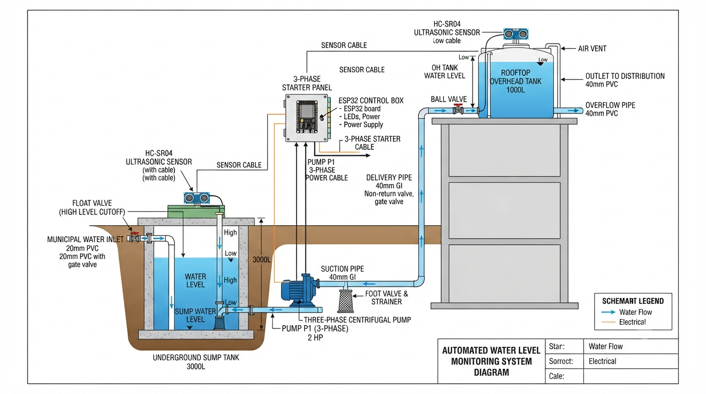

<div align="center">

# 💧 AquaGuard — Smart Dual-Tank Water Management & Pump Rotation System

**Automated ESP32 & MQTT Controller for Multi-Pump Three-Phase Building Water Supply**

[](https://www.espressif.com/)
[](https://mqtt.org/)
[](#hardware-architecture)
[](#simulation--design-renders)

[Overview](#-overview) • [System Architecture](#-system-architecture) • [3-Phase Relay & Contactor Safety](#-3-phase-pump-control-architecture) • [Enclosure & UI](#-enclosure--operator-interface) • [MQTT Dashboard](#-mqtt-mobile-dashboard) • [Repository Layout](#-repository-structure)

</div>

---

## 📖 Overview

High-rise and multi-storey buildings rely on an **underground sump tank** (fed by municipal supply) and a **rooftop overhead tank**. When pumps run continuously for long durations—or when the underground sump runs dry—motors overheat and burn out.

**AquaGuard** solves this using an **ESP32-based control and telemetry unit** that:
- Continuously measures water levels in **both tanks** using `HC-SR04` ultrasonic sensors.
- Enforces **dry-run protection** so no pump starts unless the underground tank has sufficient water.
- Implements **round-robin multi-pump rotation (2–3 three-phase pumps)** so individual motors cool down between cycles.
- Provides a **local 16×2 LCD panel** and **Green/Red manual push buttons** on a weather-resistant enclosure.
- Streams live pump status, active pump count, elapsed runtime, and site location over **MQTT** for remote monitoring from anywhere.

> **Project Note:** Currently developed as a full system architecture, circuit/logic simulation, and 3D enclosure design package prior to physical panel fabrication.

---

## 🏗️ System Architecture

<div align="center">
  
  <br />
  <em>End-to-end dual-tank sensing, dry-run interlock, and three-phase pump rotation layout.</em>
</div>

### Operational Logic Flow

| Step | Condition | System Action |
| :--- | :--- | :--- |
| **1. Demand Check** | Overhead tank level drops below `LOW_THRESHOLD` | Controller requests a fill cycle. |
| **2. Dry-Run Interlock** | Underground sump level is below `MIN_SAFE_LEVEL` | **Blocks pump start**, flashes warning LED, and publishes a `LOW_SUMP_ALERT` via MQTT. |
| **3. Pump Rotation** | Overhead tank low **AND** Sump tank healthy | Selects the next available pump in sequence (`Pump 1 → Pump 2 → Pump 3`) to distribute thermal load. |
| **4. Runtime Tracking** | Selected pump energizes | Local `16×2 LCD` displays active pump ID and live running timer (`HH:MM:SS`). |
| **5. Auto Cutoff** | Overhead tank reaches `FULL_THRESHOLD` (or Sump hits dry-run limit) | De-energizes active pump, logs runtime, and queues the next pump for the subsequent cycle. |

---

## ⚡ 3-Phase Pump Control Architecture

> **Important Electrical Engineering Note:** A standard 5V ESP32 relay module **cannot** switch a 415V three-phase motor directly. Doing so will destroy the relay and create a severe electrical hazard.

To safely control **3-phase pumps**, the control chain uses a **two-stage switching architecture**:

```text
[ESP32 GPIO (3.3V)] ──▶ [Opto-Isolated 5V Relay Module] ──▶ [3-Phase Magnetic Contactor + Thermal Overload Relay] ──▶ [3-Phase Pump Motor (R, Y, B)]
